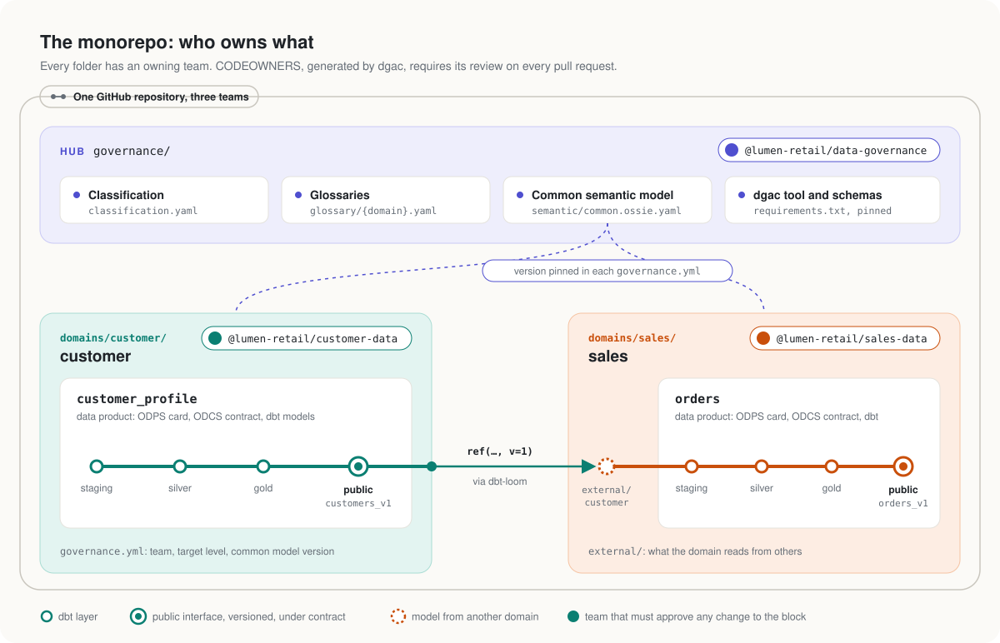
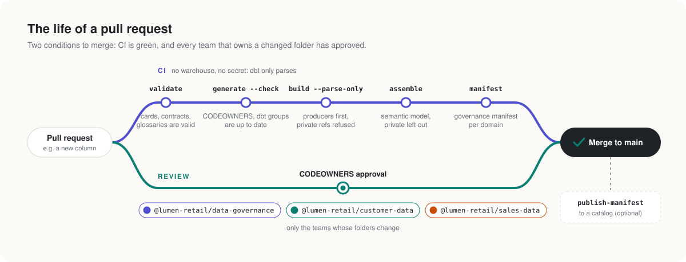
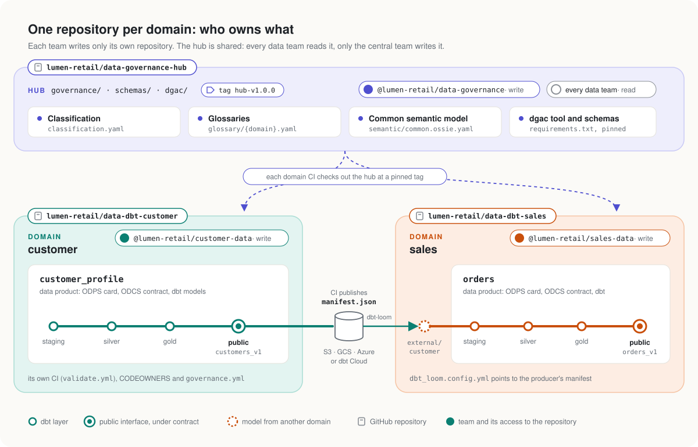

# Data Governance as Code

Your data governance rules, written as files in the repository where your data teams already work, and checked on every pull request.
Who owns each data product, what other domains may use, what is promised to them, what the shared metrics mean.

This repository is a template and the reference implementation of the [standard](STANDARD.md).
Its example is Lumen Retail, a fictional home-goods retailer with two data domains: **Customer** and **Sales**.
Sales reads Customer's public interface and derives `revenue_france` from the company's common definition of `revenue`.

## Try it

```bash
pip install -e ".[dbt]"   # installs the `dgac` command, with dbt Core, DuckDB and dbt-loom
dgac validate             # every governance file against its schema
dgac build                # dbt builds each data product on its own, producers first (local DuckDB)
                          # (CI runs `dgac build --parse-only`: no warehouse needed)
dgac assemble             # common semantic model + each product's extension → plain Ossie
dgac manifest             # build/<domain>/governance-manifest.json
```

Open `build/sales/governance-manifest.json`: owners, interfaces, contracts, what Sales reads from Customer, its shared and private metrics.
`dgac` works from any folder of the repository. `dgac --help` lists every command.

## Use it for your company

1. Click **Use this template** on GitHub, clone your new repository and install the tool as above.
2. Remove the example and set the hub up:

   ```bash
   dgac init --organisation "Acme" --central-team @acme/data-governance
   ```

   This deletes the Lumen Retail domains, their glossaries and the example's common semantic model, and regenerates CODEOWNERS.
   It also replaces the tool's source (`dgac/`, `schemas/`, `tests/`, `pyproject.toml`) with `requirements.txt`, which pins a release of the tool (see [Upgrade the tool](#upgrade-the-tool)). Reinstall it: `pip install -r requirements.txt`.
3. Review the sensitivity levels in `governance/classification.yaml`.
4. Create your domains and data products (see [For domain teams](#for-domain-teams)). Start small: one domain, two products.
   Already have a dbt project? Start from it instead: see [Adopt an existing dbt project](#adopt-an-existing-dbt-project).
5. Protect `main` (see [Access and branch protection](#access-and-branch-protection)). Without it, nothing is enforced.

The governance check in CI never connects to your warehouse (see [Connect your warehouse](#connect-your-warehouse)): the central team needs no warehouse access to run it.

## What's inside

```
governance/                     the hub, kept by the central data governance team
  hub.yml                       central team, standard version, common semantic model version
  classification.yaml           sensitivity levels: public, internal, confidential, restricted
  glossary/{domain}.yaml        business terms, one file per domain
  semantic/common.ossie.yaml    metrics and dimensions the whole company shares (Apache Ossie)

domains/{domain}/               one dbt project per domain (or one repository: data-dbt-{domain})
  governance.yml                standard version, target level, domain team, pinned versions
  external/                     consumer zone: the only place another domain's data enters
  dataproducts/{product}/       producer zone: one folder = one data product = one dbt group
    _data_product.odps.yaml     product card (ODPS): owners, status, classification, personal data
    staging/ silver/ gold/      internal layers, private
    public/                     public interface: {interface}_v1.sql + its contract {interface}_v1.odcs.yaml
    {product}.ossie.yaml        semantic extension: the product's metrics, derived from the common ones

schemas/                        what CI validates (the standard's schemas, ODCS, ODPS, Ossie)
dgac/                           the standard's tool (Python package, `pip install`)
                                after `dgac init`, both come from the release pinned in requirements.txt
STANDARD.md · RULES.md          the standard and its 37 rules
```

Files marked `Generated` in their first line come from the cards and extensions: `.github/CODEOWNERS`, `_group.yml`, `selectors.yml`, `_semantic.generated.yml`. Run `dgac generate` after an edit; CI fails if they are stale.

## For domain teams

**What the standard asks.** Each domain declares a target level in `governance.yml`. Level 1 rules always block a pull request; levels 2 and 3 block once you target them. The governance committee sets a floor and a deadline.

| Level | What it guarantees |
| --- | --- |
| 1. Identified | Every data product has a folder, a card, a Data Owner, a Steward and a tech owner |
| 2. Isolated | Other domains see only `public/`; everything from other domains enters through `external/` |
| 3. Under contract | Public interfaces are versioned, under an ODCS contract, described, classified and fresh |

The template declares level 1. Its two example products meet level 3.

**Create a domain.** `dgac new-domain finance --team @acme/finance-data` creates `domains/finance/` (a dbt project) and `governance/glossary/finance.yaml`. Its dbt profile is `finance`: define it for your warehouse (see [Connect your warehouse](#connect-your-warehouse)).

**Add a data product.**

```bash
dgac new-product sales returns --team @lumen-retail/sales-data \
    --owner julien.fabre@lumen.example --steward amelie.roche@lumen.example
```

Fill in the purpose, classification and `containsPii` in the card, then write your models in `staging/`, `silver/` and `gold/`.
Shared macros and seeds carry the product's prefix: `returns__...`.

**Publish an interface.** `dgac new-interface sales returns refunds` creates `public/refunds_v1.sql`, `refunds.yml` and the contract `refunds_v1.odcs.yaml` (status `proposed`). The contract is the source of truth: the dbt columns follow it. A new public interface needs the Data Owner's approval (GOV-A01).

**Change an interface.** Adding a column or improving a description is a minor change: raise the contract's minor version. Removing, renaming or retyping a column breaks consumers:

1. add `{interface}_v2.sql` and `- v: 2` in the model's YAML, and a contract `{interface}_v2.odcs.yaml` at version `2.0.0`;
2. set the v1 contract to `status: deprecated` with an `endOfLife` at least 3 months later (`slaProperties`);
3. get the Data Owner's approval (GOV-A02) and tell the consuming domains (the manifest lists them);
4. delete v1 after its end of life, once no domain reads it.

**Read another domain.** Add a model in `external/{domain}/` that selects from `ref('{domain}', '{interface}', v=1)`, attach it to your product's group, and declare the producer's manifest in `dbt_loom.config.yml`. dbt refuses references to private models of another domain.

**Add metrics.** Write `{product}.ossie.yaml`. Derive from a common metric rather than copying its formula:

```yaml
metrics:
  - name: revenue_france          # starts with its parent's name
    derived_from: revenue
    filters: [{field: customers.country, equals: France}]
```

Metrics built on internal layers are `private: true`: the domain computes them, other domains never see them. Changing the common model needs the governance committee (GOV-A04).

## Adopt an existing dbt project

You do not need to start from an empty project. `dgac adopt` sets the standard up on the dbt project you already have, and moves, renames and deletes nothing.

```bash
# the project in its own repository: run it there, with a copy of the hub next to it
dgac --hub ../hub --domain . adopt finance --team @acme/finance-data
# or the project copied into the monorepo, as domains/finance/
dgac adopt finance --team @acme/finance-data
```

It adds `governance.yml`, the `dataproducts/` and `external/` zones (appended to `model-paths`), `.dbtignore`, `dbt_loom.config.yml` and the domain's glossary. The project keeps its name: `governance.yml` records it as `dbt_project`. Your `selectors.yml` is kept. An existing `CODEOWNERS` keeps its lines; the generated ones go in a delimited block at its end. In a repository of its own, the project also gets `.github/workflows/governance.yml`.

Then reach level 1, one data product at a time:

1. `dgac new-product finance invoicing --team ... --owner ... --steward ...` creates the folder, the card and the dbt group.
2. Move the product's models into it: `git mv models/marts/finance/fct_invoices.sql dataproducts/invoicing/gold/`. A model keeps its name, so every `ref()` still works. Keep your subfolders if you prefer them to `staging/`, `silver/`, `gold/`; the layers matter at level 2.
3. **Settings given by folder in `dbt_project.yml` (`+materialized`, `+schema`, `+tags`...) do not follow a moved model.** Copy them under the product's block, `models: <project>: invoicing:`. To check nothing changed, compare before and after the move:

   ```bash
   dbt ls --resource-type model --output json --output-keys "name config" > before.json
   ```

   dbt also warns about "configuration paths ... which do not apply to any resources" once a folder is empty.
4. `dgac validate && dgac build --parse-only`, and open a pull request.

Leave the project's models in `models/` until their product is identified: level 1 asks every model to belong to a product (GOV-109), but nothing breaks meanwhile. Do not make models private (`+access: private`) before level 2: a private model can only be read inside its group.

A single dbt project for the whole company is a centralised organisation in the standard's terms: adopt it as one domain with several products, and split it into domains later if you need to.

## Connect your warehouse

The required check (`validate`) never reads data. `dgac build --parse-only` runs `dbt parse` with a throwaway DuckDB profile under your profile's name: no warehouse, no secret, no adapter to install. It checks what the governance needs (groups, access, versions, cross-domain references) and writes the dbt manifest the governance manifest reads. Only the physical table names (`relation`) stay empty.

Keep building and testing your models where you do today: your CI, your orchestrator or dbt Cloud. To build with `dgac build` (producers first, one product at a time):

- install your adapter (`pip install dbt-snowflake`, `dbt-bigquery`, `dbt-databricks`...);
- give dbt its profile as usual, in `~/.dbt/profiles.yml` or a folder named by `DBT_PROFILES_DIR`, with secrets read through `env_var()`. A `profiles.yml` inside a domain folder wins over both: the example's domains have one, for DuckDB.

If your project has `packages.yml` or `dependencies.yml`, dgac runs `dbt deps` first. A model that calls `env_var()` without a default needs that variable in CI, even to parse. In a repository per domain, dbt-loom must reach the producers' manifests: give the CI the credentials of the bucket that holds them.

## Access and branch protection

The standard's principle 6 says no change to a data product merges without its code owners. GitHub enforces it only once `main` is protected.

**1. Create the teams.** One GitHub team for the central data governance team, one per domain or product team, with the handles used in `hub.yml`, `governance.yml` and the product cards. Give each team **Write** access to the repository: GitHub ignores a CODEOWNERS entry for a team that cannot write. GitHub shows invalid entries when you open `.github/CODEOWNERS` in the browser.

**2. Protect `main`.** The rule set is ready in [.github/rulesets/protect-main.json](.github/rulesets/protect-main.json). Import it in **Settings → Rules → Rulesets → New ruleset → Import a ruleset**, or with the GitHub CLI:

```bash
gh api repos/{owner}/{repo}/rulesets -X POST --input .github/rulesets/protect-main.json
```

It requires a pull request, one approval from the code owners of every changed folder, a new approval after each push, and a green `validate` check. It forbids force pushes and deleting `main`. On a private repository, rulesets need a paid GitHub plan (Team or Enterprise).

**What this gives you.**

| Change | Who must approve |
| --- | --- |
| A data product's folder | Its tech owner (`team.name` in the card) |
| The rest of a domain folder (`governance.yml`, `external/`, dbt settings) | The domain team (`team` in `governance.yml`) |
| `governance/` (glossary, classification, common semantic model), `schemas/`, `dgac/` | The central data governance team |

**What it does not give you.** In a single repository every team can *read* every domain's code; GitHub cannot hide a folder. The Data Owner's and the committee's approvals (GOV-A01 to A04) are collected outside GitHub in V1. Access to the data itself (warehouse grants, masking) is out of the standard's scope.

## Monorepo

This template is a monorepo: one GitHub repository holds the hub and every domain, as folders. Each team approves the changes to its own folders (CODEOWNERS), and every team can read all the code.



A pull request merges once CI is green and every team that owns a changed folder has approved:



## One repository per domain

The monorepo is the easiest way to start, and the standard accepts it. A federated company that wants each team to see and write only its own code splits it:



1. **The hub.** Create it from this template, run `dgac init`, and tag a release (`git tag hub-v1.0.0`). Domains pin a release, so a change to the hub reaches them when they choose.
2. **A domain.** From the hub, `dgac new-domain finance --team @acme/finance-data --repo ..` creates `../data-dbt-finance`, with its own CI, CODEOWNERS and README. Push it as a new repository, then:
   - in `.github/workflows/validate.yml`, set the release tag of the hub (the `TODO` line). The hub repository is read from the hub's `origin` remote; if the hub has none, set it too. The domain's CI installs the tool the hub pins in `requirements.txt`;
   - add a secret `HUB_READ_TOKEN`: a token that can read the hub (a fine-grained token, or a GitHub App), because the default CI token cannot read another private repository.
3. **Reading another domain.** dbt-loom needs the producer's `target/manifest.json`. The domain CI uploads it as an artifact; for daily use, copy it to a bucket that dbt-loom reads directly (S3, GCS, Azure, or dbt Cloud) and point `dbt_loom.config.yml` to it.
4. **Who reads whom.** In a monorepo, `dgac manifest` sees every domain and lists the consumers of each interface. Across repositories each manifest lists what its domain reads; collect the manifests in one place to know the consumers.

## Both at once, and moving a domain into the hub

A hub can hold some domains in `domains/` and leave others in their own repositories: dgac treats each domain by where it lives. `dgac new-domain x` creates one in the hub, `dgac new-domain x --repo ..` one in its own repository. Domains read each other through dbt-loom as usual: a domain in the hub that another repository reads publishes its dbt manifest too (a bucket, or `publish-manifest.yml`).

To move a domain from its repository into the hub:

1. Copy the repository into `domains/<domain>/` of the hub (`git subtree add --prefix domains/<domain> <url> main` keeps its history).
2. Delete what only served the repository: `domains/<domain>/.github/`, `.gitignore` and `README.md`.
3. Run `dgac generate`: the hub's CODEOWNERS now lists the domain. Open a pull request on the hub.
4. Optionally, in the hub's domains that read it, point `dbt_loom.config.yml` to `../<domain>/target/manifest.json` instead of the bucket.
5. Archive the old repository. If it stays active, its CI fails once it pins a hub release that holds the domain: `dgac validate` refuses a domain that lives in two places.

## What each command does

Every command reads the hub (`governance/`). In a monorepo it also reads every domain in `domains/`; in a repository per domain it reads the domain named with `--domain`, as its CI does (`dgac --hub hub --domain . validate`).

| Command | What it does | Monorepo | Repository per domain |
| --- | --- | --- | --- |
| `validate` | Checks the hub's files (hub settings, classification, glossaries, common semantic model) and each domain's (`governance.yml`, product cards, contracts, semantic extensions) against their schemas | The hub and every domain | In the domain's CI: the hub at its pinned release, and the domain. In the hub's CI: the hub only |
| `generate` | Rewrites the generated files: CODEOWNERS, dbt groups, selectors, dbt semantic config. `--check` fails if one is stale | One CODEOWNERS for the whole repository | The domain's own CODEOWNERS and dbt files; the hub's CODEOWNERS in the hub |
| `build` | Runs dbt, producers first: `dbt parse` with `--parse-only` (no warehouse), else `dbt build` one product at a time | Every domain, in order; a consumer reads its producer's manifest on disk | The domain only; the domains it reads come through dbt-loom, from their published manifests |
| `assemble` | Writes each product's semantic model: the common model plus the product's extension, private semantics left out | Every product | The domain's products |
| `manifest` | Writes `build/<domain>/governance-manifest.json`: owners, interfaces, contracts, what the domain reads and who reads it | Complete, with the consumers of each interface | What the domain reads, but not its consumers: collect the manifests in one place to know them |

Run from a hub with no domain in `domains/`, `build`, `assemble` and `manifest` say so and do nothing.

## Upgrade the tool

After `dgac init`, your repository holds your governance, not the tool. `requirements.txt` pins a release of `dgac`, which brings the schemas with it:

```
dgac[dbt] @ git+https://github.com/maketools-company/datagovernance-as-code@v1.0.0
```

To upgrade, change the tag, run `pip install -r requirements.txt`, `dgac validate` and `dgac generate`, and open a pull request: the central team approves it (`requirements.txt` is theirs in CODEOWNERS). `dgac --version` shows the installed version.

If your CI cannot reach GitHub, keep a copy of the tool in the repository instead: `dgac init --keep-tool`. It then installs from `pyproject.toml`, and you upgrade by copying `dgac/` and `schemas/` from a newer release.

## Built on standards

| For | We use |
| --- | --- |
| Product cards | [ODPS v1.1.0](https://bitol-io.github.io/open-data-product-standard/) (Bitol, Linux Foundation), with the standard's profile |
| Data contracts | [ODCS v3.2.0](https://bitol-io.github.io/open-data-contract-standard/) (Bitol, Linux Foundation) |
| Shared semantics | [Apache Ossie 0.1.1](https://github.com/apache/ossie) (incubating), formerly Open Semantic Interchange |
| Transformations, ownership, interfaces | dbt groups, model access, model versions and contracts; [dbt-loom](https://github.com/nicholasyager/dbt-loom) for cross-project references with dbt Core |
| Review | GitHub CODEOWNERS and rulesets |

## License

[Apache 2.0](LICENSE)
