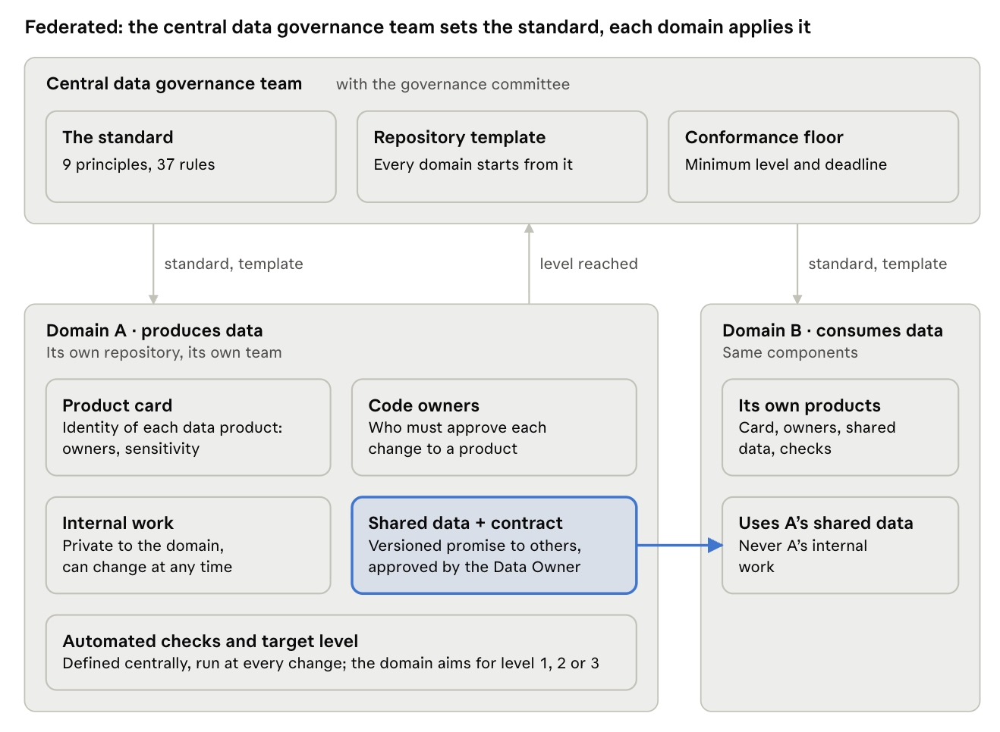

# Data Governance as Code: standard specification

Version 1.0 · A Maketools standard · Apache 2.0

## Why

“It’s only when data governance rules are in the code that they’re truly implemented.”

In most organisations the data governance team has written the rules somewhere: who owns a dataset, what another team is allowed to consume, what must be documented, how sensitive data is flagged. They live in slide decks or on a wiki page. Data teams, meanwhile, work in Git. Between the two there is no link. A broken rule goes unnoticed until the first incident or the first audit.

The goal of this standard is to make data governance rules visible and executable in the place where people already work, and make compliance something that can be measured instead of declared. It links the business and data worlds, so that data governance is finally operationalised.

## What Data Governance as Code is

Data Governance as Code is a standard for structuring a data transformation repository so that its governance rules are written as files and checked automatically.

Three ideas carry it:

- **The rule lives in the repository.** Ownership, the boundary of a data product, what other domains may use, the promises made to them: each is a file or a folder, versioned with the code.
- **The repository is the single source of truth.** No separate RACI spreadsheet, no catalogue entry typed by hand. Anything built on top (documentation, a catalogue, a dashboard) reads the repository.
- **Compliance is measured, not declared.** Every rule has an identifier and an automated check. A repository is at a known conformance level, and teams climb levels at their own pace above a floor the governance committee sets.

The standard is tool-agnostic in its principles and gives a binding for dbt on GitHub. It is a Maketools standard, meant to be deployed as-is at different organisations.

## Target context

The standard targets an organisation that splits its data by data domain and publishes data products that other domains consume. How to draw the domains is covered in [The Data Domains Map Enigma](https://thedatagovernanceplaybook.substack.com/p/the-data-domains-map-enigma). That covers two situations:

- In a data mesh, the organisation is federated: each domain team owns, builds and publishes its own data products, under common rules set centrally.
- In a centralised organisation, a single data team builds everything but wants to organise its work as data products, each with a clear owner and boundary.

| Assumption | Consequence in the standard |
| --- | --- |
| Data domains are identified (Customer, Payment, Product…) | One repository per domain, or one root folder per domain in a monorepo |
| A domain publishes several data products | One folder per data product |
| Every data product has a named owner | Product card and code ownership are mandatory |
| Domains consume each other's products | Producer and consumer zones are kept apart |
| Transformations are versioned in Git and deployed by CI | Rules are checked on every pull request |

**Technical baseline.** GitHub and dbt are fixed. The choice between dbt Core and dbt Cloud is open, and so is the tool for cross-project references (dbt Cloud's native support, or an open-source plugin such as dbt-loom). Shared semantics use Apache Ossie (Incubating), formerly Open Semantic Interchange; its version is pinned, because the specification is still at 0.x.

**Out of scope for v1:** source ingestion, warehouse access management (grants, masking), the choice of orchestrator, the automated checks themselves, and any user interface for business roles. This version delivers the repository template and a minimal semantic assembly script.

## Roles

The standard names seven roles. Only the domain team writes data product code; the others own decisions, definitions or compliance.

| Role | Responsibility in the standard |
| --- | --- |
| Central data governance team | Maintains the standard, the repository template, the common semantic model and, later, the shared checks |
| Governance committee | Sets the conformance floor and its deadline, appoints Data Owners, arbitrates disputes between domains |
| Domain team (tech owner) | Builds the data products, writes product cards and contracts, owns the code |
| Data Owner | Business owner of a data product, accountable for it; approves changes that affect other domains (new public interface, breaking change, reclassification) |
| Data Steward | Business definitions, column classification, quality rules; stands in for the Data Owner when needed |
| DPO | Validates data classification and the presence of personal data |
| Consuming domains | Use public interfaces only; are told about deprecations |

Each data product names three of them in its product card: a Data Owner, a Data Steward and a tech owner.

## Principles

Nine principles define the standard. They hold whatever the tool; the rest of this document says how they apply to dbt.

1. **A data product is a visible unit of the repository.** One folder, one dbt group, one accountable owner. Every model belongs to exactly one data product.
2. **Every data product has a product card.** Name, description, status, Data Owner, Data Steward, tech owner, classification. People and machines both read it.
3. **Producer and consumer are kept apart.** What a domain produces and what it borrows from other domains never sit in the same place.
4. **Only the public interface may be consumed.** Other domains see the public models of a data product and nothing else. Everything else is private and may change without notice.
5. **A public interface is versioned and under contract.** Changing it in a breaking way means publishing a new version, never editing the existing one.
6. **Ownership is enforced by the tooling.** No change to a data product merges without the approval of its code owners.
7. **Compliance is measured.** Every rule has an identifier and a check; every repository has a known conformance level.
8. **Data is classified.** Every data product declares its sensitivity and whether it holds personal data. On public interfaces, classification goes down to the column.
9. **Semantics are federated.** A common core of metrics and dimensions is defined once, then extended and derived by the domains. Each domain may also define its own semantics for its specific needs.

## Overview diagram

The central data governance team writes the standard, provides the repository template and, with the governance committee, sets the minimum level every domain must reach. Each domain applies the standard in its own repository: a card and code owners for every data product, internal work kept private, shared data under a contract approved by the Data Owner, and automated checks that show the level reached. Domains use each other's shared data, never each other's internal work.

## Core concepts

The rules refer to a small set of concepts. Their names in the repository are fixed by the standard, because the checks look for them.

| Concept | Definition | Name fixed by the standard |
| --- | --- | --- |
| Domain repository | The repository of one data domain. In a monorepo, one root folder per domain with the same layout | `data-dbt-{domain}` or `domains/{domain}/` |
| Hub | What holds for every domain: the standard, schemas, glossary, classification levels, common semantic model | `governance/` (in the monorepo, or a hub repository) |
| Governance declaration | Which version of the standard the repository applies, which level it targets, and the domain team | `governance.yml` at the root of the domain repository or domain folder |
| Data product | A unit of data with one purpose, one owner and one boundary | A folder under `dataproducts/`, a dbt group of the same name, both in snake_case |
| Product card | The identity of a data product, readable without knowing dbt | `_data_product.odps.yaml` in the product folder (ODPS v1.1.0), kept out of dbt parsing by `.dbtignore` |
| Producer zone | Everything the domain builds | `dataproducts/` |
| Internal layers | Private transformation steps inside a product, from source to aggregates | `staging/`, `silver/`, `gold/` |
| Public interface | A versioned model other domains may consume | A model in `public/`, with `access: public` |
| Data contract | The promise attached to a public interface: schema, classification, freshness, quality, lifecycle | One `{interface}_v{n}.odcs.yaml` per interface version in `public/`, ODCS v3.2.0 |
| Consumer zone | The only place where another domain's data enters | `external/` |
| Code ownership | Which team must approve changes to each product folder | `CODEOWNERS`, generated from the product cards |
| Business glossary | The terms product cards and contracts refer to, one file per domain | `governance/glossary/{domain}.yaml` |
| Classification levels | The sensitivity levels cards and contracts use; configurable | `governance/classification.yaml` |
| Common semantic model | Business metrics and dimensions defined once for the whole organisation, owned by the central data governance team | An Ossie document maintained centrally; its version is pinned in `governance.yml` |
| Semantic extension | What a data product adds to the common model: its own metrics, dimensions, relationships and derived metrics | `{product}.ossie.yaml` in the product folder |
| Assembled semantic model | The common model merged with one extension into a standalone Ossie document, without private semantics | `build/semantic/{domain}/{product}.assembled.ossie.yaml`, generated |
| dbt semantic configuration | MetricFlow semantic models and metrics generated from the common model and the extension, private semantics included | `_semantic.generated.yml` in the product folder, generated |
| Governance manifest | The state of a domain's governance, built by CI: products, owners, interfaces, contracts, reads, consumers, semantics | `build/{domain}/governance-manifest.json`, generated |

The product card describes the product; the contract describes each interface. A product can expose no interface (internal use only) or several.

## Product card and data contract

The product card holds what is true for the whole product; the contract holds what is promised for one interface. Nothing is written in both places.

### Product card

The card is an [ODPS v1.1.0](https://bitol-io.github.io/open-data-product-standard/) document (amendment A1), so any tool that reads ODPS reads it. The standard adds a profile, `schemas/data-product.profile.schema.json`, that makes its fields mandatory.

| Field of the standard | Required | ODPS field | Content |
| --- | --- | --- | --- |
| name | Yes | `id` | Same as the product folder and the dbt group; `name` holds a readable label |
| domain | Yes | `domain` | The owning domain |
| description | Yes | `description.purpose` | One or two sentences a business reader understands |
| status | Yes | `status` | `draft`, `proposed`, `active`, `deprecated` or `retired` (the values ODCS uses) |
| Data Owner | Yes | `team.members[]` with `role: data-owner` | Business owner, accountable |
| Data Steward | Yes | `team.members[]` with `role: data-steward` | Stands in for the Data Owner when needed |
| tech owner | Yes | `team.name` | GitHub team that maintains the code; CODEOWNERS is generated from it |
| classification | Yes | `customProperties[]` with `property: classification` | A level of `governance/classification.yaml` (by default `public`, `internal`, `confidential`, `restricted`) |
| contains_pii | Yes | `customProperties[]` with `property: containsPii` | Whether the product holds personal data |
| glossary_terms | Recommended | `authoritativeDefinitions[]` | Links to `governance/glossary/{domain}.yaml#{term}` |

The card does not list interfaces or consumers. The governance manifest derives them from `public/` and from the cross-project references dbt sees, and exports a complete ODPS document with its ports. The dbt group of the product (`_group.yml`) is generated from the card, which stays the only source of truth for owners (amendment A3).

### Data contract

One contract per public interface version, named `{interface}_v{n}.odcs.yaml` like the dbt model file `{interface}_v{n}.sql` (amendment A8), in [ODCS v3.2.0](https://bitol-io.github.io/open-data-contract-standard/latest/) format. It is the source of truth for the interface's schema; the dbt column definitions follow it.

| What the contract states | ODCS field |
| --- | --- |
| Standard version, contract id, contract version | `apiVersion`, `kind`, `id`, `version` (all required by ODCS) |
| Status | `status` |
| Columns, types, keys | `schema[].properties`: `logicalType`, `primaryKey`, `unique` |
| Column classification | `classification`, `criticalDataElement` |
| Freshness, frequency, retention | `slaProperties`: `latency`, `frequency`, `retention` |
| Guaranteed quality | `quality` rules, with a `dimension` |
| End of a deprecated version | `slaProperties`: `endOfSupport`, `endOfLife` |
| Owners | `team.name` and `team.members` with a role, copied from the product card |

Two ODCS points to respect: the `dataProduct` field is deprecated since ODCS v3.1.0 and is not used (the file's location links it to its product), and ODCS has no owner field, so ownership is a role in `team.members`.

## Shared semantics

Semantics are federated. A common core, such as the definition of revenue, is defined once; domains extend it and derive from it, and each domain may also add its own semantics for needs that are specific to it. Semantics are written in [Apache Ossie](https://github.com/apache/ossie) (Incubating), the open standard formerly called Open Semantic Interchange.

### Common model and domain extensions

- **The common semantic model** holds what the whole organisation must mean the same way: shared dimensions (calendar, customer, country…) and enterprise metrics (revenue, active customers…). The central data governance team owns their definitions. The data behind them always comes from a domain's public interfaces, under contract.
- **A semantic extension** is written by each data product that exposes metrics. It may derive from common metrics, and it may also define the product's own metrics, dimensions and relationships for needs specific to the domain. These domain-specific semantics belong to the domain and are not reviewed centrally.
- **The assembled model** is produced by CI: the common model plus one extension, merged into one standalone Ossie document. Private semantics are left out of the version published to other domains. It is the version other tools read. The dbt semantic configuration is generated from the same assembly, private semantics included, because the domain computes them (amendment A6). A domain-specific metric that other domains come to need can be promoted to the common core by the central team; it then leaves the extension.

### Derived metrics

A derived metric reuses a common metric and only adds a filter or a breakdown. The Sales domain, for example, declares `revenue_france` as derived from `revenue` with the filter country = France. It does not copy the revenue formula: assembly combines the common formula with the filter. When the central team corrects the definition of revenue, `revenue_france` follows as soon as the domain moves to that version of the common model (its version is pinned in governance.yml).

### Rules

- Shared semantics (the common core, derived metrics, and anything a domain exposes to others) point only to public interfaces: the product's own, or other domains' through the consumer zone. Private semantics, for a domain's own use, may point to its internal layers; they are marked private in the extension, left out of the model published to other domains, and no other domain may use them. To share a private metric, the domain first moves it onto a public interface.
- A domain adds; it never redefines. A metric or dimension with the name of a common one is refused.
- A derived metric names its parent, keeps its parent's name as a prefix (`revenue_france`), and filters or breaks down only on dimensions that exist in the model.
- The Ossie version is pinned in `governance.yml`. Ossie's latest release is 0.1.1; version 0.3.0 is in preparation and may change the format.

### Changes to shared semantics

- **The common model** changes only with the approval of the governance committee.
- **A new shared metric** exposed by a domain needs no Data Owner approval: adding a metric breaks nobody.
- **Changing the definition of a shared metric is a breaking change**, whether the metric is common or exposed by a domain. It follows the lifecycle of public interfaces: a new major version of the model, the previous version kept available for at least 3 months, consuming domains told.

**A Maketools convention, not an Ossie feature.** Ossie today has one model per document and no references between models. Reuse of datasets and relationships across models is on Ossie's roadmap, not in the specification. The common model and the assembly step are therefore defined by this standard, and the output stays plain Ossie. If Ossie adds reuse between models, the convention will move to it.

## Versioning and lifecycle

A public interface is never edited in a breaking way: it gets a new major version, and the old one stays available for at least 3 months.

1. **Publication.** A new model appears in `public/` with contract version 1.0.0. The Data Owner must approve it.
2. **Non-breaking change.** A column is added, a description improved. The contract's minor or patch version goes up; no approval is needed.
3. **Breaking change.** A column is removed, renamed or retyped. This requires a new dbt model version and a new contract major version (dbt v2 = contract 2.x.y). The Data Owner must approve it.
4. **Deprecation.** When v2 is published, the v1 contract moves to `status: deprecated` and declares an `endOfLife` at least 3 months later. Consuming domains are told.
5. **Removal.** v1 is deleted after its `endOfLife`, and only once no domain references it any more.

### Approvals

Three changes affect other domains and need the Data Owner's approval before they merge: a new public interface, a new major version, and a change of classification. Changes to the common semantic model are approved by the governance committee. The standard sets the rule; how the approval is collected is outside v1.

If the Data Owner does not answer within 5 working days, the Data Steward may approve instead. The exception: when the request comes from the Steward, it stays with the Data Owner, so nobody approves their own request.

## Conformance levels

A repository is not "compliant" or "non-compliant": it sits at one of three levels, and each level only contains rules a machine can check.

| Level | What it guarantees | Main rules |
| --- | --- | --- |
| 1. Identified | Every data product has a folder, a card and owners | Card present and valid; Data Owner, Steward and tech owner named; one dbt group per product; every model in a group |
| 2. Isolated | Other domains see only the public interface | Only `public/` models are public; other domains read only through `external/`; shared macros and seeds carry their product's prefix |
| 3. Under contract | The public interface is stable, documented and classified | ODCS contract on every public model; contract enforced at build; every public column described and classified; freshness declared and tested; cross-domain reads through cross-project references; semantic extensions build on the common model without redefining it |

The full list, with each rule's identifier, is in [RULES.md](RULES.md).

**What blocks a merge.** Level 1 rules always block. Level 2 and 3 rules only warn until the repository declares that level as its target in `governance.yml`; from then on they block. The governance committee sets a floor and a deadline for every domain (for example level 2 within 6 months); a domain may aim higher, sooner.

What no script can check (has the Data Owner really accepted the role? is the classification right?) is covered by yearly human reviews, outside the levels.

## What the template must deliver

The v1 deliverable is a repository template: the starting point every new domain copies. The automated checks come later, so the template must satisfy the rules by construction. The folder-by-folder design belongs to the technical specification.

**Must**

- [ ] Create a new domain repository, or a `domains/{domain}/` folder in a monorepo, from a domain name.
- [ ] Contain every element whose name the standard fixes (see Core concepts).
- [ ] Ship a `governance.yml` declaring standard version 1.0 and target level 1.
- [ ] Ship the JSON Schema of the product card.
- [ ] Keep the product card out of dbt parsing, so the project parses without warnings.
- [ ] Make each data product buildable and deployable on its own.
- [ ] Give each public interface its ODCS contract, valid against the ODCS v3.2.0 JSON Schema.
- [ ] Work with dbt Core and with dbt Cloud.
- [ ] Declare in `governance.yml` the version of the common semantic model and the Ossie version the repository uses.
- [ ] Include a minimal assembly script that merges the common semantic model with a product's extension into one standalone Ossie document, leaves private semantics out of the published version, and generates the dbt semantic configuration from it.

**Should**

- [ ] Include one example data product that meets all level 3 rules, as a living reference for teams.
- [ ] Give the example data product a semantic extension with at least one derived metric (for example a common metric filtered on one country).
- [ ] Include a README for domain teams: what the standard asks, how to add a product, how to publish or version an interface.
- [ ] Show the naming convention for shared macros and seeds (`{product}__` prefix).

**Acceptance test:** a new domain repository created from the template, with its example product, satisfies every rule of the catalogue at levels 1, 2 and 3 when reviewed by hand.

## Decisions and rationale

These choices are settled. Reopen one only with a reason that the rationale below does not already cover.

| Decision | Why |
| --- | --- |
| Principles are tool-agnostic; dbt is one binding | The standard must outlive a dbt syntax change and stay usable on other tools |
| Monorepo accepted alongside one repository per domain | Many central teams start from a single dbt project; forcing a split blocks adoption |
| Product card kept outside dbt | Business roles must read it without knowing dbt, and other tools must read it too |
| The product card is the source of truth for owners | Avoids two diverging copies (card and dbt group config) |
| Three roles in the card (Data Owner, Steward, tech owner) | Simple to fill; a full RACI is built separately |
| Data Steward is mandatory | They stand in for the Data Owner on approvals |
| Medallion layer names (`staging`, `silver`, `gold`) | Business readers know them; one vocabulary, not two |
| Contracts in ODCS, one file per public interface | Open standard, readable outside dbt, consistent with a card outside dbt |
| Retention, freshness and quality live in the contract, not the card | They depend on the interface, not on the product |
| Consumers derived from real references, not declared | A hand-kept list goes stale |
| To read another domain's data, a domain links to that domain's public model (a cross-project reference). Declaring the other domain's table directly as a plain source is accepted at levels 1 and 2, not at level 3 | With a link to the public model, dbt knows it is another domain's interface and checks its access, version and contract. A plain source works with any setup but checks none of this, so it is only a starting point |
| 3 months minimum between two major versions | Gives consuming domains time to migrate |
| Three levels with machine-checkable rules only | A level must be measurable; human judgement goes in yearly reviews |
| Committee sets a floor, domains may go higher | Gives a common pace without blocking teams that are ahead |
| Separate `governance.yml` | Read by any tool without going through dbt |
| Shared macros and seeds prefixed by product | dbt namespaces them globally; folders alone do not isolate them |
| One orchestration run per product by default; small products may share one | Each product deploys alone, without one DAG per three-table product |
| Semantics in Ossie; dbt semantic configuration generated from it | Open, tool-agnostic standard, same logic as ODCS for contracts; a converter to dbt MetricFlow exists |
| Federated semantics: a common core, extended and derived by domains, plus domain-specific semantics | Enterprise metrics keep one definition; domains keep the freedom to model their own needs |
| Derived metrics reference their parent instead of copying its formula | A correction to a common metric reaches every derived metric |
| Composition by CI assembly, pinned Ossie version | Ossie 0.x has no reuse between models; the output stays plain Ossie, and the convention can move to native reuse when Ossie adds it |
| Private semantics may use internal work; shared semantics only public interfaces | A metric for the domain's own use should not require a public interface, a contract and an approval; anything others rely on keeps the contract's protection |
| The governance committee approves changes to the common semantic model | The common model is shared by every domain; no single Data Owner owns it |
| A new shared metric needs no approval; changing a shared metric's definition is a breaking change | Adding a metric breaks nobody; changing what a metric means breaks every report built on it, so it gets versions and 3 months' notice |
| A minimal semantic assembly script ships with the v1 template | Without it, the example product cannot produce an assembled model or meet the semantic rules |

## Amendments of the V1 template

The V1 template applies the specification of 11 November 2026 with these changes. They are to be confirmed in the next version of the specification.

| # | Amendment | Rules affected |
| --- | --- | --- |
| A1 | The product card is an ODPS v1.1.0 file, `_data_product.odps.yaml`, with a profile that requires the standard's fields | GOV-101 to GOV-105, GOV-107, GOV-110 |
| A2 | Product folders and dbt groups use snake_case (`customer_profile`), the identifier dbt expects; it is also the macro and seed prefix | GOV-103, GOV-108, GOV-204 |
| A3 | The dbt group is generated from the card, the only source of truth for owners | GOV-108 |
| A4 | A `.dbtignore` keeps cards, contracts and Ossie files out of dbt parsing | — |
| A5 | The hub holds the glossary (`governance/glossary/`) and the configurable classification levels (`governance/classification.yaml`); `governance.yml` names the domain team | GOV-110, GOV-111 |
| A6 | Assembly has two outputs: the published Ossie model without private semantics, and the dbt semantic configuration with them | GOV-315, GOV-319 |
| A7 | CI builds a governance manifest per domain; sending it elsewhere is an optional, disabled example | — |
| A8 | One contract file per interface version, `{interface}_v{n}.odcs.yaml`, so that a deprecated version and its successor coexist | GOV-301, GOV-311 |
